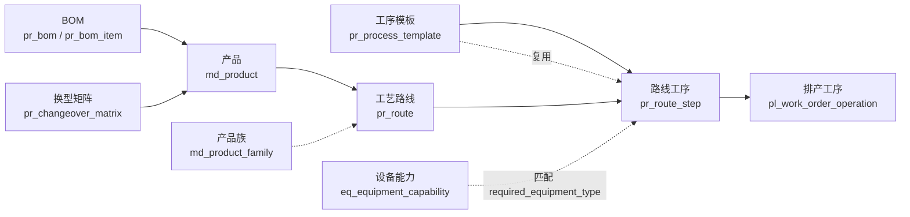

# 工序模板与产品族数据字典 v1.0（B / W1·D5）

> 交付对象：A（回填 `docs/er-v1.md` 第 3.1 节，并把本文件作为字段级明细附在其后）。
> 依据：《产品说明书 v1.2》5.3 / 7.2.1、《AI 协作与角色工作包 v1.1》6.2 / 2.5 / 2.6、`docs/er-v1.md` v1.0、`docs/api-contract.md` v1.0。
> 范围：工艺配置中心（M03）三层结构所需表 + 只读引用表。**W1 只出文档，不写代码、不建迁移。**
> 字段类型为 PostgreSQL 类型；命名、数量/金额、时间、枚举口径全部按《工作包》2.3 / 2.5 / 2.6。

## 0. 版本与变更

| 版本 | 日期 | 变更 | 作者 |
|---|---|---|---|
| v1.0 | 2026-10-23 | 初稿：三层结构 6 张表 + 2 张只读引用表字段级定义、枚举、编码、校验规则、错误码 | B |

## 1. 总则

### 1.1 三层结构（多品种的核心）

| 层 | 表 | 职责 | 谁维护 |
|---|---|---|---|
| 第一层：标准工序 | `pr_process_template` | 定义"粗车、精车、钻孔……"的标准工时、所需设备类型、关键参数、检验要求。**可被任意路线复用** | B |
| 第二层：产品族 | `md_product_family` | 工艺相似的零件归族（盘类 / 轴类 / 板类），族内共享路线模板 | **A（masterdata）**，B 只读 `family_id` |
| 第三层：工艺路线 | `pr_route` + `pr_route_step` | 由模板按 seq 拼接成某产品的路线；允许插入专用工序；带版本 | B |
| 配套 | `pr_bom` + `pr_bom_item` | 单层 BOM，供齐套检查与领料 | B |
| 配套 | `pr_changeover_matrix` | 产品两两换型分钟数，多品种排产的核心约束 | B（数据源见 03 文档） |
| 只读 | `eq_equipment_capability` | 设备能执行哪些 step_type、精度、产能 | **D**，B 只读（I-11） |

### 1.2 表清单与落地状态

| 表名 | 模型类 | 应用 | 负责人 | 当前状态 |
|---|---|---|---|---|
| pr_process_template | ProcessTemplate | process | B | 待建（W2 D1） |
| pr_route | ProcessRoute | process | B | 待建（W2 D1） |
| pr_route_step | RouteStep | process | B | 待建（W2 D1） |
| pr_bom | Bom | process | B | 待建（W2 D2） |
| pr_bom_item | BomItem | process | B | 待建（W2 D2） |
| pr_changeover_matrix | ChangeoverMatrix | process | B | 待建（W2 D5） |
| md_product_family | ProductFamily | masterdata | A | A 维护，B 只读 |
| md_product | Product | masterdata | A | A 维护，B 只读 |
| md_material | Material | masterdata | A | A 维护，B 只读 |
| eq_equipment_capability | EquipmentCapability | equipment | D | D 维护，B 只读 |

### 1.3 通用字段约定（所有业务表）

| 字段 | 类型 | 说明 |
|---|---|---|
| id | bigint 自增 | 主键，全项目统一 |
| created_at / updated_at | timestamptz | 自动维护，输出 ISO 8601 |
| remark | text | 备注，允许为空；单据/主数据表统一叫 remark |
| code | varchar | 业务编码，唯一；**换型矩阵无 code**（产品对即业务主键） |

### 1.4 表名前缀说明（需 A 在 ER 中确认）

`docs/er-v1.md` 与《工作包》6.2 使用 `pr_`、`or_`、`pl_` 这类**应用短前缀**；而《工作包》2.3 写的是"应用名_小写下划线"（如 `process_template`）。本文件**沿用 er-v1 的 `pr_` 前缀**，理由是 er-v1 是 A 维护的唯一 ER 口径、且《工作包》6.2 同款写法。

> 待办（交 A）：在 `er-v1.md` §四 补一句"表名 = 应用短前缀 + 实体，process=pr、order=or、planning=pl、masterdata=md、inventory=in、production=pd、quality=qa、equipment=eq、logistics=lg"，消除与 §2.3 的表述差异。

### 1.5 产品族归属（与 roles 文档冲突，按 api-contract 执行）

| 文档 | 写法 | 结论 |
|---|---|---|
| 《工作包》6.2 / 6.3 | `pr_product_family`、`/api/v1/process/families/` | **作废**（早于 W1 修正） |
| `api-contract.md` §2.2 #18 + §六变更记录 | 产品族归 `masterdata/families/`，A 维护，B 只读引用 | **以本行为准** |
| `er-v1.md` §3.1 | 未列产品族表，只在 `pr_route.family_id` 引用 | 一致 |

→ B 侧**不建** `pr_product_family`，不提供 `/process/families/`；需要"按族取参考路线"时用**工艺路线接口的筛选参数** `?family_id=` 实现（见 `05-工艺与计划用户故事` US-B-03）。

## 2. 字段级字典

### 2.1 pr_process_template 工序模板

| 字段 | 中文 | 类型 | 必填 | 默认 | 约束 / 取值 | 说明 |
|---|---|---|---|---|---|---|
| id | 主键 | bigint 自增 | ✔ | — | PK | |
| code | 模板编码 | varchar(32) | ✔ | — | 唯一；`PT-###` | 编码生成器产出，如 PT-002 |
| name | 模板名称 | varchar(64) | ✔ | — | — | 如"粗车" |
| step_type | 工序类型 | varchar(32) | ✔ | — | 枚举 §3.1 | 设备能力按此匹配 |
| std_hours | 标准工时 | decimal(8,3) | ✔ | — | > 0 且 ≤ 24 | **单件工时，单位小时** |
| required_equipment_type | 所需设备类型 | varchar(32) | ✔ | — | 枚举 §3.2 | 排产据此匹配设备 |
| key_params | 关键工艺参数 | jsonb | | null | 必须是对象 | 转速、进给、切深、刀具等，随工艺变 |
| inspection_rule | 检验要求 | jsonb | | null | 必须是对象 | 首件/抽检比例/关键尺寸/量具 |
| is_active | 是否启用 | bool | ✔ | true | — | 停用后不可被**新建或修改**的路线引用 |
| remark | 备注 | text | | null | — | |
| created_at | 创建时间 | timestamptz | 自动 | — | — | |
| updated_at | 更新时间 | timestamptz | 自动 | — | — | |

唯一约束：`code`；索引：`(step_type)`、`(is_active)`。

> 与 er-v1 差异：er-v1 §3.1 未列 `is_active` / `remark` / `created_at` / `updated_at`，按全项目约定补齐（新增字段，不改变既有语义）。

### 2.2 md_product_family 产品族（A 维护，B 只读）

| 字段 | 中文 | 类型 | B 是否需要 | 说明 |
|---|---|---|---|---|
| id | 主键 | bigint | ✔ 引用 | 存进 `pr_route.family_id` |
| code | 族编码 | varchar(32) | ✔ | `PL` 盘类 / `SH` 轴类 / `BN` 板类（编码规则 §4） |
| name | 族名称 | varchar(64) | ✔ | 盘类 / 轴类 / 板类 |
| description | 描述 | varchar(255) | | |
| is_active | 是否启用 | bool | ✔ | 停用族下产品不可新建路线 |

B 只读约束：**不改表、不新增字段**；需要新字段先按 I-04 向 A 提需求。

### 2.3 pr_route 工艺路线

| 字段 | 中文 | 类型 | 必填 | 默认 | 约束 / 取值 | 说明 |
|---|---|---|---|---|---|---|
| id | 主键 | bigint 自增 | ✔ | — | PK | |
| code | 路线编码 | varchar(64) | ✔ | — | 唯一；`PR-<产品编码>-V<版本>` | 如 PR-PF-PL-001-V1 |
| product_id | 产品 | bigint 外键→md_product | ✔ | — | 必须存在且 is_active | 一条路线只属于一个产品 |
| family_id | 产品族（冗余） | bigint 外键→md_product_family | | — | **保存时校验 = product.family_id** | 便于按族查参考路线；不一致即 400 |
| version | 版本 | int | ✔ | 1 | ≥ 1 | 同产品版本号递增，不复用 |
| status | 状态 | varchar(16) | ✔ | draft | 枚举 §3.3 | 同一产品最多一条 active |
| remark | 备注 | text | | null | — | |
| created_at / updated_at | — | timestamptz | 自动 | — | — | |

唯一约束：`code`、`(product_id, version)`；索引：`(product_id, status)`、`(family_id, status)`。

### 2.4 pr_route_step 路线工序

| 字段 | 中文 | 类型 | 必填 | 默认 | 约束 / 取值 | 说明 |
|---|---|---|---|---|---|---|
| id | 主键 | bigint 自增 | ✔ | — | PK | |
| route_id | 所属路线 | bigint 外键→pr_route | ✔ | — | 级联删除 | |
| seq | 工序序号 | int | ✔ | — | ≥ 10，建议步长 10；**(route_id, seq) 唯一** | 10/20/30…，留插入余量；删除后重排 |
| template_id | 工序模板 | bigint 外键→pr_process_template | 条件 | null | `is_special=false` 时必填 | 专用工序为空 |
| step_type | 工序类型（冗余） | varchar(32) | ✔ | — | 枚举 §3.1，取模板值或专用填写 | 排产、报工、追溯都按此字段识别 |
| std_hours | 标准工时（本零件） | decimal(8,3) | ✔ | — | > 0 且 ≤ 24 | **覆盖**模板值（同一模板不同零件工时可不同） |
| required_equipment_type | 所需设备类型 | varchar(32) | ✔ | — | 枚举 §3.2，可覆盖模板值 | 例：连接板下料改用加工中心 |
| key_params | 关键参数（覆盖） | jsonb | | 模板值 | 对象 | 为空时取模板值 |
| inspection_rule | 检验要求（覆盖） | jsonb | | 模板值 | 对象 | 为空时取模板值 |
| is_special | 是否专用工序 | bool | ✔ | false | — | true=模板库之外的一次性工序 |
| remark | 备注 | text | | null | — | |
| created_at / updated_at | — | timestamptz | 自动 | — | — | |

索引：`(route_id, seq)`。

### 2.5 pr_bom / pr_bom_item BOM（第一代单层，不做装配体）

**pr_bom 主表**

| 字段 | 中文 | 类型 | 必填 | 默认 | 约束 / 取值 | 说明 |
|---|---|---|---|---|---|---|
| id | 主键 | bigint 自增 | ✔ | — | PK | |
| code | BOM 编码 | varchar(64) | ✔ | — | 唯一；`BM-<产品编码>-V<版本>` | |
| product_id | 产品 | bigint 外键→md_product | ✔ | — | — | |
| version | 版本 | int | ✔ | 1 | ≥ 1 | |
| status | 状态 | varchar(16) | ✔ | draft | 枚举 §3.4 | 同一产品最多一条 active |
| remark | 备注 | text | | null | — | |
| created_at / updated_at | — | timestamptz | 自动 | — | — | |

唯一约束：`code`、`(product_id, version)`。

**pr_bom_item 明细**

| 字段 | 中文 | 类型 | 必填 | 默认 | 约束 / 取值 | 说明 |
|---|---|---|---|---|---|---|
| id | 主键 | bigint 自增 | ✔ | — | PK | |
| bom_id | 所属 BOM | bigint 外键→pr_bom | ✔ | — | 级联删除 | |
| material_id | 物料 | bigint 外键→md_material | ✔ | — | 必须存在 | 物料主数据由 A 维护 |
| qty_per | 单件用量 | decimal(12,3) | ✔ | — | > 0 | 每 1 件产品消耗量，单位取自 material.uom |
| loss_rate | 损耗率 | decimal(5,2) | | 0 | 0 ~ 100 | 存百分数（如 5.00 表示 5%） |
| is_substitute | 是否替代料 | bool | ✔ | false | — | 第一代仅做展示，不参与齐套自动替换 |
| remark | 备注 | text | | null | — | |

唯一约束：`(bom_id, material_id)`。

### 2.6 pr_changeover_matrix 换型时间矩阵

| 字段 | 中文 | 类型 | 必填 | 默认 | 约束 / 取值 | 说明 |
|---|---|---|---|---|---|---|
| id | 主键 | bigint 自增 | ✔ | — | PK | |
| from_product_id | 前产品 | bigint 外键→md_product | ✔ | — | 必须存在 | |
| to_product_id | 后产品 | bigint 外键→md_product | ✔ | — | 必须存在；**≠ from_product_id** | 同产品换型按 0 处理，不建行 |
| changeover_minutes | 换型分钟数 | int | ✔ | — | 0 ~ 480 | 单位**分钟/次**，取值口径见 `03-换型矩阵数据来源与取值口径.md` §3 |
| source | 数据来源 | varchar(16) | ✔ | estimated | 枚举 §3.5 | 估值必须可追溯 |
| remark | 备注 | text | | null | — | 记录依据（工艺标准条款号 / D 提供日期） |
| updated_at | 更新时间 | timestamptz | 自动 | — | — | 矩阵只改不删，便于对比 |

唯一约束：`(from_product_id, to_product_id)`；索引：`(from_product_id)`、`(to_product_id)`。

### 2.7 eq_equipment_capability 设备能力（D 写，B 只读）

| 字段 | 中文 | 类型 | 说明 |
|---|---|---|---|
| id | 主键 | bigint | — |
| equipment_id | 设备 | bigint 外键→eq_equipment | — |
| step_type | 可执行工序类型 | varchar(32) | **必须使用 §3.1 / `07-step_type取值字典.md` 的同一套 11 个值** |
| precision_level | 精度等级 | varchar(16) | 如 IT6 / IT7 / IT8 |
| capacity_per_hour | 标准产能 | decimal(10,3) | 件/小时 |
| params | 动态参数 | jsonb | 行程、主轴转速范围、最大装夹尺寸等 |
| — | 唯一约束 | — | `(equipment_id, step_type)` |

B 只读：排产时用 `route_step.required_equipment_type` + `step_type` 反查可执行该工序的设备；数据由 D 通过 `/equipment/equipments/{id}/capabilities/` 维护。

## 3. 枚举值表（写入 models 常量类，前端下拉走字典 I-02）

### 3.1 step_type 工序类型（B 定义，D 的设备能力表引用）

> **v1.0 已按 D 的设计评审意见定稿，完整定义与匹配口径见 `07-step_type取值字典.md`（2026-11-02，采纳 D 的 11 值）。** 本表只留速查。

| 值 | 中文 | 默认设备类型 |
|---|---|---|
| cutting | 下料 | lathe（板料可覆盖为 machining_center） |
| rough_turning | 粗车 | lathe |
| finish_turning | 精车 | lathe |
| milling | 铣削（铣面） | machining_center |
| slot_milling | 铣槽 | machining_center |
| gear_milling | 铣齿 | machining_center |
| drilling | 钻孔 | drill |
| grinding | 磨削（外圆） | grinder |
| deburring | 去毛刺 | deburr_station |
| cleaning | 清洗 | washer |
| inspection | 检验 | inspection_station |

> 与 W1 初稿的差异：`milling` 拆出 `slot_milling`；`gear_hobbing` → `gear_milling`；`washing` → `cleaning`。原因见 07 文档 §1。

### 3.2 required_equipment_type 设备类型（与 D 的设备台账一致）

| 值 | 中文 | 说明 |
|---|---|---|
| lathe | 数控车床 | ×2 |
| machining_center | 加工中心 | ×2 |
| drill | 钻床 | ×1 |
| grinder | 磨床 | ×1 |
| washer | 清洗机 | ×1 |
| deburr_station | 去毛刺台 | ×1 |
| inspection_station | 检验工位 | 三坐标/影像仪 ×2 |

> 缺口提示（交 D）：现有 8 台设备**没有专用下料设备（锯床）与滚齿机**。W1 方案：棒料在车床切断、板料在加工中心铣外形、齿形在加工中心铣齿；若 D 后续新增设备，只需在 `eq_equipment_capability` 声明 `step_type`，**不改代码**。

### 3.3 route.status / 3.4 bom.status

| 值 | 中文 | 允许流转 |
|---|---|---|
| draft | 草稿 | draft → active；draft → obsolete |
| active | 生效 | active → obsolete |
| obsolete | 停用 | 终态，不可回转（要改就新建版本） |

规则：同一产品**最多一条 active**；active 的路线/BOM 不允许物理删除（用状态停用）。

### 3.5 changeover.source 数据来源

| 值 | 中文 | 使用条件 |
|---|---|---|
| standard | 工艺标准 | 教师/工艺文件给出的换型标准时间 |
| measured | 实测 | 由工单实际起止时间反推（W6 起可用） |
| estimated | 估值 | 按动作分解估算（W1 初值，必须复核） |
| imported | 批量导入 | Excel 导入且未标来源时的兜底值 |

## 4. 编码规则（已与《说明书》7.3 对齐）

| 对象 | 规则 | 示例 | 谁生成 |
|---|---|---|---|
| 产品族 | `PL` / `SH` / `BN` | PL | A |
| 产品 | `PF-<族代码>-<3 位序号>` | PF-PL-001 法兰盘 A | A |
| 物料 | `MT-<2 位类别>-<4 位序号>` | MT-RM-0001（RM=原材料，PP=外购件，CS=辅材） | A |
| 工序模板 | `PT-<3 位序号>` | PT-002 粗车 | B / services 生成器 |
| 工艺路线 | `PR-<产品编码>-V<版本>` | PR-PF-PL-001-V1 | B |
| BOM | `BM-<产品编码>-V<版本>` | BM-PF-PL-001-V1 | B |
| 换型矩阵 | 无 code | — | — |

编码生成器统一放 `apps/process/services.py`，禁止在 serializers 里拼字符串。

## 5. 唯一约束与索引清单（W2 建迁移时逐条落实）

| 表 | 约束 / 索引 |
|---|---|
| pr_process_template | UNIQUE(code)；INDEX(step_type)；INDEX(is_active) |
| pr_route | UNIQUE(code)；UNIQUE(product_id, version)；INDEX(product_id, status)；INDEX(family_id, status) |
| pr_route_step | UNIQUE(route_id, seq)；INDEX(route_id) |
| pr_bom | UNIQUE(code)；UNIQUE(product_id, version) |
| pr_bom_item | UNIQUE(bom_id, material_id) |
| pr_changeover_matrix | UNIQUE(from_product_id, to_product_id)；CHECK(from_product_id <> to_product_id)；INDEX(from_product_id)；INDEX(to_product_id) |

## 6. 业务校验规则清单（一律写在 services.py，错误码用 B 号段 12000–12999）

| 编号 | 场景 | 规则 | 错误码 |
|---|---|---|---|
| RT-01 | 模板/路线/BOM 新建 | code 重复 | 12001 |
| RT-02 | 模板/路线工序保存 | std_hours ≤ 0 | 12002 |
| RT-03 | 模板/路线工序保存 | std_hours > 24 | 12003 |
| RT-04 | 模板/路线保存 | step_type 或 required_equipment_type 不在枚举内 | 12004 |
| RT-05 | 路线工序保存 | (route, seq) 重复 | 12005 |
| RT-06 | 路线生效 | 工序数 < 1 | 12006 |
| RT-07 | 路线生效 | 同产品已有 active 路线 | 12007 |
| RT-08 | 模板删除 | 已被路线引用（含 draft 路线） | 12008 |
| RT-09 | BOM 明细保存 | qty_per ≤ 0 | 12009 |
| RT-10 | BOM 明细保存 | loss_rate 不在 0~100 | 12010 |
| RT-11 | BOM 生效 | 同产品已有 active BOM | 12011 |
| RT-12 | 换型矩阵保存 | changeover_minutes 不在 0~480 | 12012 |
| RT-13 | 换型矩阵保存 | from = to | 12013 |
| RT-14 | 换型矩阵保存 | 产品对重复 | 12014 |
| RT-15 | 路线保存 | family_id 与 product.family_id 不一致 | 12004（参数错误族） |
| RT-16 | 路线复制 | 目标产品已有 active 路线 | 12022 |
| RT-17 | 销售订单保存 | 明细 qty ≤ 0 | 12015 |
| RT-18 | 销售订单保存 | due_date < order_date | 12016 |
| RT-19 | 订单状态动作 | 当前状态不允许（如已排产再确认） | 12017 |
| RT-20 | MPS 生成 | 明细为空 | 12018 |
| RT-21 | 齐套检查 | 产品无 active BOM | 12019 |
| RT-22 | 排产运行 | 无可排工单 | 12020 |
| RT-23 | 排产运行 | frozen_until 非法（早于今天或格式错） | 12021 |
| RT-24 | 需求预测 | 历史周期 < 24 | 19401 |
| RT-25 | 需求预测 | model 不在支持列表 | 19402 |
| RT-26 | 需求预测 | 算法执行异常 | 19403 |

> 号段依据：《工作包》2.4.4 与 `api-contract.md` §1.3。B 只用 12000–12999 与算法异常 1940x，**不得占用 10001（A 的演示错误码）**。

## 7. 初始数据清单（W2 D1 录入，明细见 `02-六种零件工艺路线清单.xlsx`）

### 7.1 工序模板 11 个（pr_process_template）

| 模板编码 | 名称 | step_type | 标准工时(h) | 所需设备类型 | 参数/检验要点 |
|---|---|---|---|---|---|
| PT-001 | 下料 | cutting | 0.250 | lathe | 锯切/切断；长度余量 2mm |
| PT-002 | 粗车 | rough_turning | 0.500 | lathe | 800r/min、0.2mm/r、切深 2mm、单边余量 1.5mm |
| PT-003 | 精车 | finish_turning | 0.400 | lathe | 1200r/min、0.1mm/r、切深 0.3mm |
| PT-004 | 铣面 | milling | 0.350 | machining_center | 3000r/min、500mm/min、切深 1mm、上下两面 |
| PT-005 | 铣槽 | milling | 0.400 | machining_center | φ10 立铣刀、3000r/min、500mm/min |
| PT-006 | 钻孔 | drilling | 0.250 | drill | 1000r/min、进给 0.15mm/r |
| PT-007 | 铣齿 | gear_hobbing | 0.800 | machining_center | 模数 2.5、齿数 24、成形铣刀 φ70 |
| PT-008 | 磨外圆 | grinding | 0.500 | grinder | 60 粒度、切深 0.02mm、Ra0.8 |
| PT-009 | 清洗 | washing | 0.150 | washer | 清洗液 60℃、5min |
| PT-010 | 去毛刺 | deburring | 0.200 | deburr_station | 手工/砂带、约 10min |
| PT-011 | 检验 | inspection | 0.300 | inspection_station | FQC、AQL 1.0、3 项关键尺寸 |

### 7.2 六种零件与工艺路线（pr_route / pr_route_step）

| 产品编码 | 零件 | 产品族 | 工序数 | 单件总工时(h) | 路线（按 seq） |
|---|---|---|---|---|---|
| PF-PL-001 | 法兰盘 A | 盘类 PL | 5 | 1.700 | 下料→粗车→精车→钻孔→检验 |
| PF-PL-002 | 端盖 B | 盘类 PL | 5 | 1.850 | 下料→粗车→精车→铣槽→检验 |
| PF-SH-001 | 齿轮轴 C | 轴类 SH | 6 | 2.750 | 下料→粗车→精车→铣齿→磨外圆→检验 |
| PF-SH-002 | 轴套 D | 轴类 SH | 4 | 1.450 | 下料→粗车→精车→检验 |
| PF-BD-001 | 连接板 E | 板类 BN | 4 | 1.200 | 下料（覆盖为加工中心）→铣面→钻孔→检验 |
| PF-PL-003 | 压盖 F | 盘类 PL | 6 | 1.850 | 下料→粗车→精车→钻孔→清洗→检验 |
| **合计** | 6 种 | 3 族 | **30** | **10.800** | 每零件 4~6 道工序（W1 判据） |

### 7.3 其他初始数据

| 类别 | 数量 | 内容 |
|---|---|---|
| 产品族 | 3 | 盘类 PL、轴类 SH、板类 BN（A 先建） |
| 产品 | 6 | 法兰盘 A、端盖 B、齿轮轴 C、轴套 D、连接板 E、压盖 F |
| BOM | 6 条（各 1 行物料） | W2 用，非 W1 验收项 |
| 换型矩阵 | 30 个产品对 | 初值为估值，待 D 复核（见 03 文档） |

> 说明：第 6 种零件「压盖 F」为满足"6 种零件"验收而暂定（说明书 2.3 只列了 5 种 + 通用清洗），已列入 00 文档的待拍板事项；产品编码、图号、物料编码归 A 的 masterdata。

## 8. 提交前自检（对《工作包》2.8 八条的落实）

| # | 自检项 | 本模型对应做法 |
|---|---|---|
| 1 | 标准响应体 | 复用 A 的 renderers.py / exceptions.py，不自行包装 |
| 2 | 接口进 urls.py + Swagger | W2 建 routes/templates 时同步登记 `docs/api-status.md` |
| 3 | 业务校验在 services.py | 上表 RT-01~RT-26 全部落 services |
| 4 | 金额/数量用 Decimal | std_hours decimal(8,3)、qty_per / qty decimal(12,3)、loss_rate decimal(5,2) |
| 5 | 迁移文件一起提交 | W2 每个应用一次 makemigrations + migrate |
| 6 | 权限配置 | 工艺配置：工艺员可写、计划员只读；由 A 的权限码接入 |
| 7 | 错误码在号段内 | 12000–12999 + 1940x |
| 8 | 不硬编码 URL | 前端 `src/api/process.js` 统一封装 |

## 9. 待 A 确认的字段级问题（周会 5 分钟过完）

| # | 问题 | B 的建议 | 影响 |
|---|---|---|---|
| Q1 | 产品族归属（process 还是 masterdata） | 按 api-contract：masterdata，A 维护 | 决定 B 是否建族表、是否提供 /process/families/ |
| Q2 | 表名短前缀（pr_ / or_ / pl_…）是否写进 er-v1 §四 | 是，补一行说明 | 避免与 §2.3 表述冲突 |
| Q3 | 路线/BOM 状态枚举 draft/active/obsolete 是否登记进 er-v1 §五与会话字典 | 是 | 前端 StatusTag 与字典要能翻译 |
| Q4 | 工艺路线/BOM 的 code 编码规则（PR-…/BM-…）是否补进《说明书》7.3 与字典 | 是 | 编码生成器依赖 |
| Q5 | `pr_process_template.is_active`、`pr_changeover_matrix.source` 两个新增字段是否同意 | 同意，理由见 §2.1 / §2.6 | ER 图与迁移字段数 |
